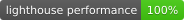
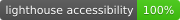
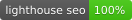
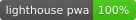
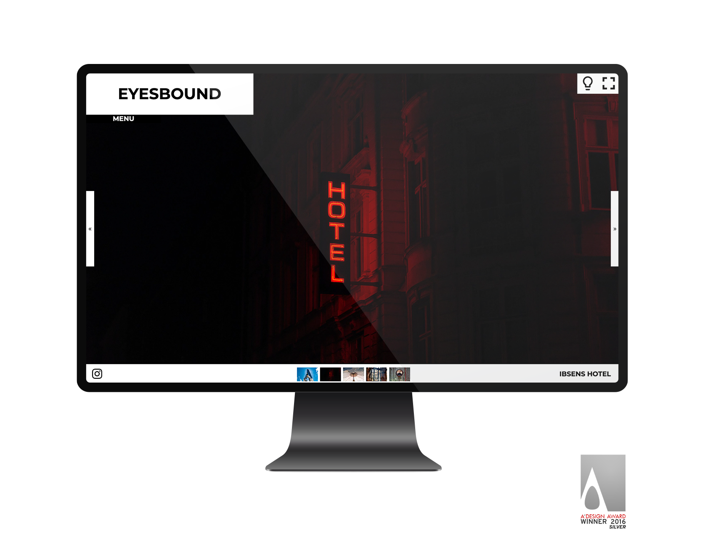

# Eyesbound
[](https://github.com/xojs/xo)
[](https://web.dev/performance-scoring/)
[](https://developers.google.com/web/fundamentals/accessibility)

[](https://developers.google.com/search/docs/advanced/guidelines/webmaster-guidelines)
[](https://web.dev/pwa-checklist/)
[](https://codecov.io/gh/Primajin/eyesbound)
[](http://creativecommons.org/licenses/by-nc-sa/4.0/)



Website for a Berlin based photographer: a static [Astro](https://astro.build) site with content from [Prismic](https://prismic.io), served from Cloudflare Workers static assets.

## Development

Requires Node.js >= 22.4 and npm (no yarn or pnpm).

```shell
npm install
```

Create a `.env.local` file (git-ignored; `.env.example` lists every variable):

```dotenv
PRISMIC_ACCESS_TOKEN=Permanent access token from https://eyesbound.prismic.io/settings/apps/
MAPS_API_KEY=Google Maps browser key that allows http://localhost:* as referrer
```

Then run

```shell
npm run dev
```

and open `http://localhost:4321/`.

### Environment variables

| Variable | Required | Fallback when absent | Notes |
|---|---|---|---|
| `PRISMIC_ACCESS_TOKEN` | yes (real build) | none, `npm run build` fails | Build-time secret, never `PUBLIC_`-prefixed |
| `MAPS_API_KEY` | yes (real build) | none, `npm run build` fails | Ships to the browser; restrict it by HTTP referrer |
| `PRISMIC_REPO_NAME` | no | `eyesbound` | Prismic repository |
| `SITE_URL` | no | `https://eyesbound.com` (also when blank) | Canonical URLs and sitemap, no trailing slash |
| `SITE_NAME` | no | `EYESBOUND` | Used in titles and the logo |

`PRISMIC_FIXTURES=1` builds from the local fixtures in `site/lib/__fixtures__` instead of the Prismic API (used by unit tests; the fixtures deliberately include a picture without an image, so a full fixture build fails on it).

## Scripts

| Command | What it does |
|---|---|
| `npm run dev` (`npm start`) | Astro dev server |
| `npm run build` | Checks the variables (`scripts/check-env.mjs`), then `astro build` into `dist/` |
| `npm run preview` | Serves `dist/` (needs a build first) |
| `npm test` | Vitest, one run |
| `npm run coverage` | Vitest with V8 coverage (`coverage/`, text, html and lcov) |
| `npm run test:e2e` | Playwright against `astro preview` on `dist/` (needs a build first; install browsers once with `npx playwright install chromium`) |
| `npm run lint` / `lint:fix` | XO |

## Structure

```text
site                 Astro source (srcDir)
├───assets           Images and SVGs imported by pages (design award badge, Creative Commons icons)
├───components       .astro components; icons/ holds inline SVGs
├───constants        Asset types (route segments), map and site constants
├───i18n             Translation lookup, language switcher, locales/{en,de}.json
├───layouts          Base layout (head, SEO, theme and language bootstrap)
├───lib              Prismic client and data mapping, route list; __fixtures__ for tests
├───pages            File-based routes, same URLs as the old site
├───public           Copied verbatim to dist/: _headers (CSP), manifest, sw.js, icons, robots.txt
├───scripts          Browser scripts (map, slideshow, navigation, theme, fullscreen)
├───styles           Plain CSS with custom properties (tokens.css)
└───utils            Image and SEO helpers
prismic              Prismic custom type definitions (reference copy, JSON)
e2e                  Playwright specs
scripts              Build tooling (check-env.mjs, route-parity.mjs)
docs                 ADRs, hosting and cutover runbook
```

Tests sit in `__tests__` directories beside the code (`*.test.js`).

Custom types: copy the JSON of a type (e.g. `https://eyesbound.prismic.io/masks/category.json/`) to `prismic/` when it changes in Prismic.

## Testing

Unit tests run on Vitest with Astro's Vite config, `.astro` components through Astro's container API. Browser behaviour (CSP, map, slideshow, service worker) is covered by Playwright specs in `e2e/`. `node scripts/route-parity.mjs` compares the generated routes with the live sitemap. See [ADR 0002](docs/adr/0002-test-strategy-and-offline.md).

## Deployment

GitHub Actions builds once and deploys that `dist/` to Cloudflare Workers static assets; previews get an alias per pull request. Setup, secrets, cutover and rollback: [docs/hosting-cloudflare.md](docs/hosting-cloudflare.md).

## Architecture decision records

- [0001 Prismic data layer](docs/adr/0001-prismic-data-layer.md)
- [0002 Test strategy and offline support](docs/adr/0002-test-strategy-and-offline.md)
- [0003 CSP and headers](docs/adr/0003-csp-and-headers.md)
- [0004 Gatsby removal](docs/adr/0004-gatsby-removal.md)

## Migration note

The site used to be built with Gatsby and deployed on Netlify. That code is removed, see [ADR 0004](docs/adr/0004-gatsby-removal.md); older commits and ADRs still describe it.
